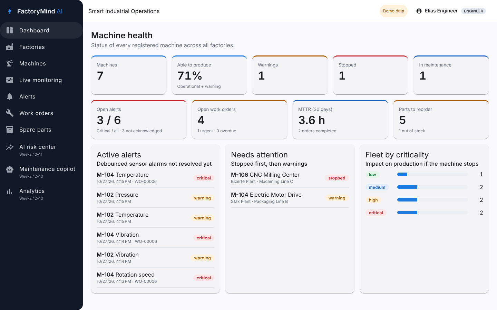
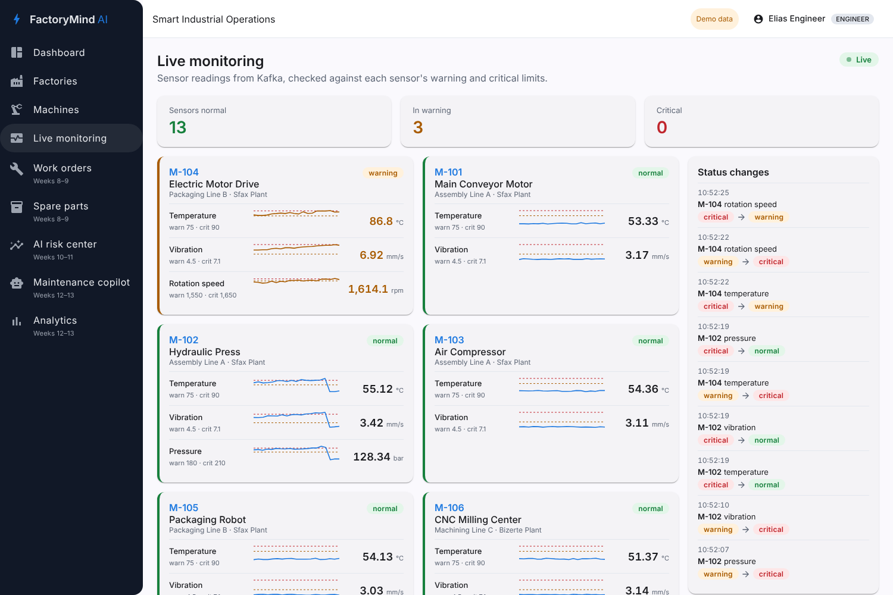
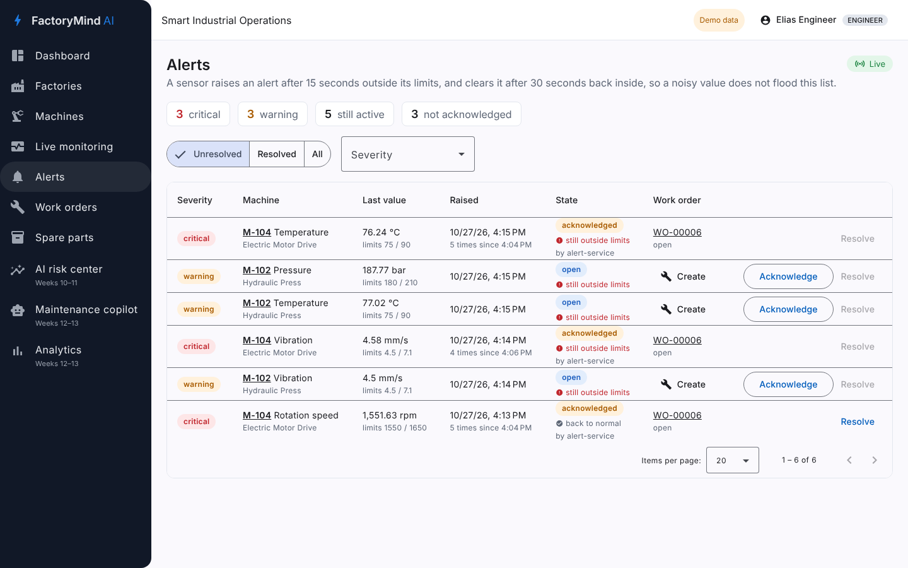
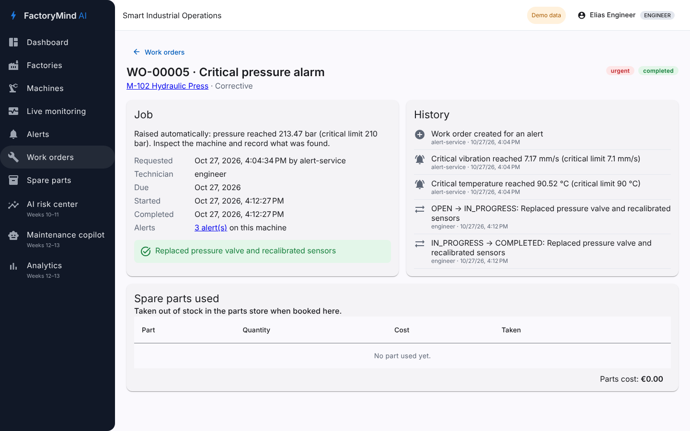
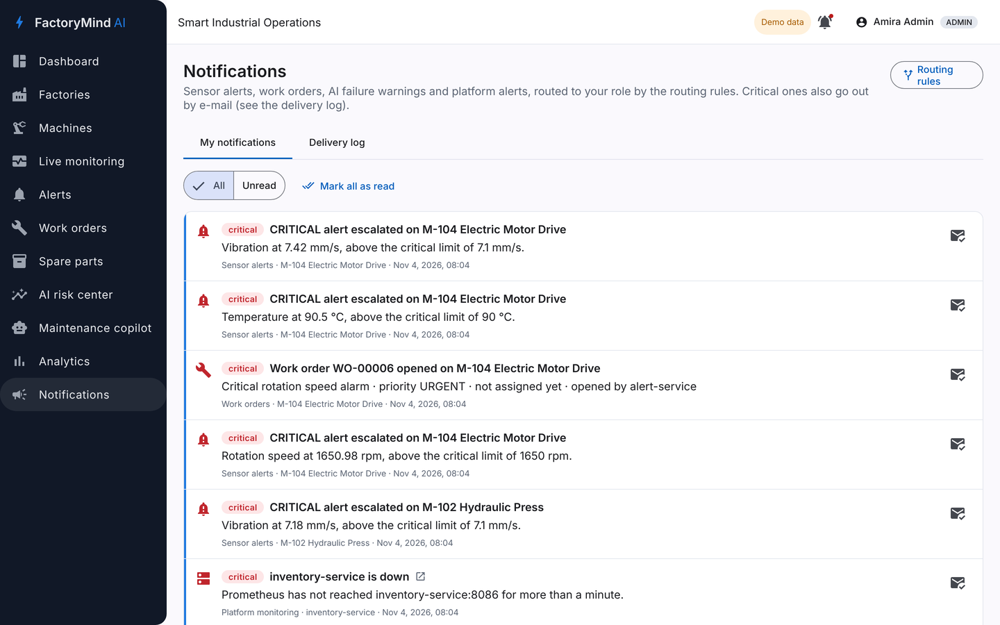
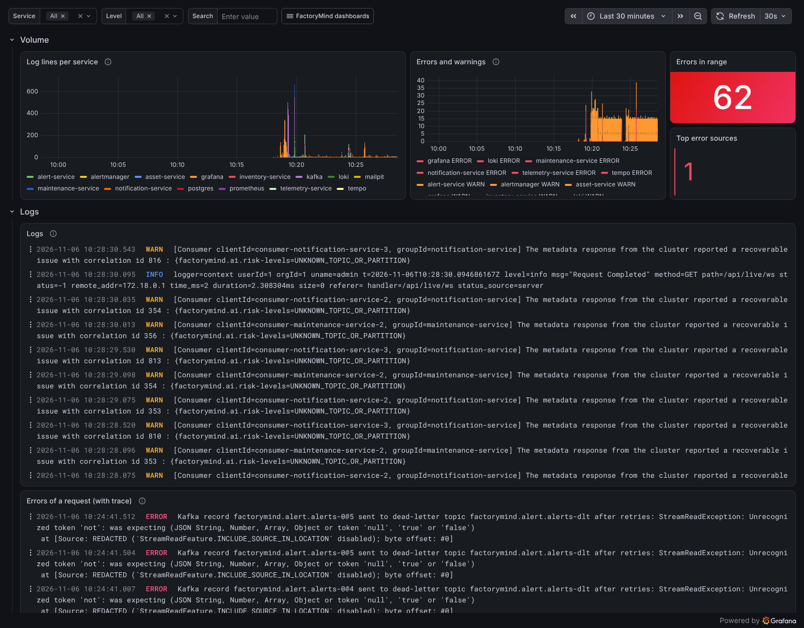

# FactoryMind AI — Smart Industrial Operations Platform

FactoryMind AI watches factory machines, detects abnormal behaviour and helps maintenance teams act before a
breakdown stops production. It is built as event-driven Spring Boot microservices with an Angular front end,
a Python ML service and Power BI analytics.

> **Demo project.** All factories, machines and sensor data are simulated. Thresholds in the demo data are
> illustrative, not industrial limits.













## What works today (phases 1–10)

| Area | Status |
|---|---|
| Factories, production lines, machines, sensor alarm limits (CRUD, search, filters, paging) | ✅ |
| Machine status (OPERATIONAL / WARNING / STOPPED / MAINTENANCE) and fleet summary | ✅ |
| API gateway in front of every service | ✅ |
| Angular dashboard, machine list, machine details, new machine form, factories | ✅ |
| Flyway migrations, demo data, RFC 9457 error responses, optimistic locking | ✅ |
| Unit, web-slice and Testcontainers integration tests, GitHub Actions CI | ✅ |
| Keycloak login (OIDC + PKCE), JWT validation in the gateway and the asset service, ADMIN / ENGINEER / OPERATOR roles | ✅ |
| Kafka (KRaft): sensor limits shared by asset-service, readings, status changes, dead-letter topics | ✅ |
| Telemetry service: threshold checks, history, latest values, live stream (SSE), sensor simulator | ✅ |
| Live monitoring screen: every sensor with sparkline, limits and a feed of status changes | ✅ |
| Alert service: debounced alerts from sensor status changes, acknowledge / resolve, live stream | ✅ |
| Maintenance service: work orders (auto-created from critical alerts), status workflow, parts used, history, MTTR | ✅ |
| Inventory service: spare parts, stock movements ledger, receipts, stock counts, low-stock view | ✅ |
| Failure-risk model (Python, scikit-learn, FastAPI) trained on simulated run-to-failure data, with a model card | ✅ |
| AI insights service: live risk per machine from Kafka telemetry, inspection work order when a machine turns HIGH | ✅ |
| Spring AI: maintenance report per machine (Claude or Ollama) | ✅ |
| Maintenance copilot: RAG on machine manuals and procedures (hybrid search Postgres full-text + pgvector), cited sources, live plant data through tool calls, document upload (Markdown, text, PDF) | ✅ |
| Preventive maintenance plans | Later |
| Analytics warehouse (star schema) loaded every 5 min from the services, simulated 6-month history for the demo | ✅ |
| Analytics page: availability, MTBF, MTTR, maintenance cost, prediction precision and recall, per machine | ✅ |
| Power BI model and reports (Executive, Reliability & Maintenance, AI Performance) on the warehouse | ✅ |
| Metrics for every service in Prometheus: traffic, errors, latency, JVM, database pools, Kafka lag, plus plant metrics (readings, alerts, work orders by origin, failure risk, stock, warehouse loads) | ✅ |
| Distributed tracing (OpenTelemetry, Grafana Tempo) across HTTP calls and Kafka, trace ids in every log line | ✅ |
| Grafana dashboards (Plant operations, Services) and 17 Prometheus alert rules, provisioned as code | ✅ |
| Notification service: sensor alerts, work orders, AI failure risk and Prometheus alerts (through Alertmanager) routed by editable rules to e-mail, Microsoft Teams and an in-app bell, with throttling, retries and a delivery log | ✅ |
| Service-to-service call with OAuth2 client credentials (notification-service reads machine names from asset-service) | ✅ |
| Central logs: every container's output in Grafana Loki (collected by Grafana Alloy), JSON lines with trace ids, log ↔ trace links, a Logs dashboard and alert rules on the logs (error bursts, dead-lettered Kafka messages) | ✅ |
| Contract tests | Later |

## Architecture

```
                 login (PKCE)
Angular (4200) ─────────────────► Keycloak (8180/auth, realm factorymind)
      │ Bearer token, live streams (SSE)       ▲ signing keys (JWKS)
      ▼                                        │
API Gateway (8080) ─┬─► asset-service (8081) ──────► PostgreSQL asset_db
                    ├─► telemetry-service (8082) ──► PostgreSQL telemetry_db
                    ├─► alert-service (8083) ──────► PostgreSQL alert_db
                    ├─► maintenance-service (8084) ► PostgreSQL maintenance_db
                    │        │ REST: issue / return parts (token relayed)
                    ├─► inventory-service (8086) ──► PostgreSQL inventory_db
                    ├─► ai-insights-service (8087) ► PostgreSQL insights_db (+ pgvector: manuals)
                    │        │ REST /predict           │ Spring AI (optional)
                    │        ▼                         ▼
                    │  ml-service (8090, Python)   Claude API or Ollama (chat), Ollama (embeddings)
                    ├─► analytics-service (8088) ──► PostgreSQL analytics_db (star schema) ◄── Power BI
                    │        reads every service database above (read-only), every 5 min
                    └─► notification-service (8089) ► PostgreSQL notification_db (rules, outbox)
                             │ e-mail (SMTP: Mailpit in dev)   │ Teams webhook   │ in-app bell (SSE)
                             ▲ Alertmanager (9093) ◄── Prometheus alert rules
                             ▲ client-credentials token from Keycloak ──► asset-service (machine names)

Every container's stdout ──► Alloy (Docker socket) ──► Loki (3100) ──► Grafana (3000) ◄── Prometheus, Tempo
                                                        └─ log alert rules ──► Alertmanager ──► notification-service

Kafka (9092)
  asset.sensor-definitions   asset ──► telemetry
  telemetry.readings         simulator / plant gateways ──► telemetry
  telemetry.sensor-status    telemetry ──► alert (debounce)
  alert.alerts               alert ──► maintenance (critical alert opens a work order)
  maintenance.work-orders    maintenance ──► alert (acknowledge, resolve when completed), ai-insights
  ai.risk-levels             ai-insights ──► maintenance (HIGH risk plans an inspection)
  (ai-insights also reads sensor-definitions, readings and alerts)
  (notification-service reads alerts, work-orders and risk-levels)
```

Each service owns its database; services talk over REST for queries and Kafka for events.
A reading travels: simulator or `POST /api/telemetry/readings` → `telemetry.readings` → telemetry-service
(limits check, stored, latest state) → live stream to the browser, and `telemetry.sensor-status` when a sensor
changes level. See [ADR 0003](docs/adr/0003-kafka-telemetry.md).
A status change then becomes an alert once it lasts 15 s (and clears after 30 s back to normal); a critical
alert opens an urgent work order, or joins the open one of the same machine; the technician books spare parts
on it, which takes them out of stock. See [ADR 0004](docs/adr/0004-alerts-maintenance-inventory.md).
Every 10 s, ai-insights-service sends each machine's latest readings to the Python model, which returns the
probability that a sensor reaches its critical limit within 24 h and the reasons; a machine that turns HIGH gets
an inspection work order, usually minutes before the first alert in the demo. See
[ADR 0005](docs/adr/0005-ai-insights-ml.md).
The maintenance copilot answers "how do I fix / check / work safely on this machine" from the manuals and
procedures: it finds the best passages with Postgres full-text search and pgvector embeddings merged by rank,
gives them to the language model with the live risks, alerts and work orders as tools, and the answer cites
each passage as [n]. See [ADR 0006](docs/adr/0006-maintenance-copilot-rag.md).
Every 5 minutes analytics-service copies what the reports need from the service databases (read-only) into a
star-schema warehouse: work orders, downtime per day, predictions with their outcome, hourly sensor summaries.
Power BI and the analytics page read it; on a fresh install it adds six months of simulated history so the trends
have something to show. See [ADR 0007](docs/adr/0007-analytics-warehouse-power-bi.md) and
[the KPI definitions](docs/analytics/kpi-definitions.md).
Every service exposes its metrics to Prometheus and sends its traces to Tempo; Grafana shows both. One trace
follows a reading from the simulator through Kafka to the alert, the work order and back, and a dot on a latency
graph opens the trace of that request. See [ADR 0008](docs/adr/0008-observability.md) and
[Observability](#observability) below.
Every container writes its logs to stdout as usual; Alloy reads them through the Docker socket and stores them in
Loki with the service, the level and the trace id, so Grafana searches the logs of the whole platform and jumps
from a log line to its trace and back. See [ADR 0010](docs/adr/0010-centralized-logs.md).
notification-service turns the events people must hear about (a raised or escalated alert, a new or completed
work order, a machine turning HIGH risk, a Prometheus alert from Alertmanager) into notifications. Routing rules
that admins edit in the app decide who gets what: e-mail, a Teams channel, or the bell of a role. Each event is
stored once (its key makes Kafka redeliveries harmless), e-mails and Teams messages go through an outbox that is
retried with exponential backoff, and a throttle window keeps one flapping sensor from sending twenty e-mails.
See [ADR 0009](docs/adr/0009-notifications-alert-routing.md).
Decisions are recorded in [`docs/adr`](docs/adr).

## Observability

| Where | What to look at |
|---|---|
| Grafana > FactoryMind > **Plant operations** (home page) | Machines, critical alerts and how fast they are acknowledged, work orders opened by ALERT / AI_PREDICTION / USER, risk per machine, model calls, spare parts, warehouse freshness |
| Grafana > FactoryMind > **Services** | Up/down, requests, 4xx/5xx, p95 latency per service and slowest endpoints, calls between services, language model latency and tokens, Kafka throughput and lag, heap, CPU, GC, DB connections |
| Grafana > Explore > Tempo > **Service graph** | Who calls whom (gateway, services, Kafka), with rate, errors and latency, drawn from the traces |
| Grafana > Explore > Tempo > Search | One request across services: e.g. `service.name = maintenance-service`, then open a trace |
| http://localhost:9090/alerts | The 17 alert rules (`infrastructure/prometheus/alerts.yml`) and which ones fire |
| http://localhost:9093 | Alertmanager: firing alerts, grouped, sent to notification-service (then e-mail / Teams / app per the rules) |
| Grafana > FactoryMind > **Logs** | Log volume per service, errors and warnings, top error sources, search by service / level / text, errors that happened inside a traced request |
| Grafana > Explore > **Loki** (sign in as admin) | Any LogQL query, e.g. `{service="maintenance-service", level="ERROR"}` or `{service=~".+"} \| trace_id="<id>"`; open a line, **View trace** opens it in Tempo |
| Grafana > Explore > Tempo > a span > **Logs for this span** | The log lines of that service with that trace id |
| http://localhost:12345 | Alloy: the log pipeline and the containers it reads |

Every Spring Boot service serves `/actuator/prometheus` (open on the Docker network only; nginx and Caddy never
forward `/actuator`), the Python model serves `/metrics`. In Docker every service logs one JSON object per line
(`LOGGING_STRUCTURED_FORMAT_CONSOLE=logstash`, with `traceId` and `spanId`); started from the IDE it keeps the
readable text format with `[traceId-spanId]`. Alloy ships every container's output to Loki (7 days kept), and two
Loki rules (`infrastructure/loki/rules`) raise alerts through Alertmanager: `ErrorLogBurst` (more than 20 errors in
5 minutes from one service) and `KafkaMessagesDeadLettered` (a consumer gave up on a message and sent it to its
`-dlt` topic).
Started from the IDE, a service exports traces only if `MANAGEMENT_OPENTELEMETRY_TRACING_EXPORT_OTLP_ENDPOINT`
is set (for example `http://localhost:4318/v1/traces` with the `tempo` container running).

## Security

Keycloak issues the tokens; the Angular app signs in with the authorization code flow and PKCE (`keycloak-js`)
and sends the access token to `/api`. The gateway rejects any call without a valid token and a FactoryMind role,
then forwards the token; the asset service checks it again and applies the role rules:

| Role | Can do |
|---|---|
| OPERATOR | Read factories, lines, machines and sensors; report a machine's status |
| ENGINEER | Everything an operator does, plus create and edit machines and sensor limits |
| ADMIN | Everything, including factories, production lines and deletes |

Every role can watch live and historical readings; pushing readings over HTTP needs ENGINEER or ADMIN.

| Area | OPERATOR | ENGINEER | ADMIN |
|---|---|---|---|
| Alerts | Read, acknowledge | + resolve | Same as engineer |
| Work orders | Read, create | + edit, change status, book parts | Same as engineer |
| Spare parts | Read | + create / edit parts, receive deliveries | + stock counts, delete parts |
| AI | Read risks, ask the copilot | + machine reports, add / remove copilot documents | Same as engineer |
| Analytics | Read KPIs | Same as operator | + start a warehouse load |
| Notifications | Own feed (bell) | + routing rules and delivery log (read) | + edit rules, send tests, retry deliveries |

Demo accounts (realm import in `infrastructure/keycloak/factorymind-realm.json`; change them before any real use):

| User | Password | Role |
|---|---|---|
| `admin` | `admin` | ADMIN |
| `engineer` | `engineer` | ENGINEER |
| `operator` | `operator` | OPERATOR |

Services also have their own Keycloak client: notification-service logs in with OAuth2 client credentials
(client `notification-service`, service account with the OPERATOR role) to read machine names from asset-service,
because Kafka events carry no user token. Alertmanager calls the notification webhook with a shared bearer token
(`ALERTMANAGER_WEBHOOK_TOKEN`), not a Keycloak token.

Keycloak admin console: http://localhost:8180/auth/admin (`KEYCLOAK_ADMIN` / `KEYCLOAK_ADMIN_PASSWORD`, default
`admin` / `admin`). See [ADR 0002](docs/adr/0002-keycloak-security.md).

## Tech stack

Java 25 · Spring Boot 4.0.9 · Spring Cloud 2025.1.4 (Gateway) · Spring for Apache Kafka · Apache Kafka 4.3 (KRaft) ·
Spring Data JPA · Flyway · PostgreSQL 17 + pgvector · Server-Sent Events ·
Spring AI 2.0.1 (Anthropic Claude, Ollama, tool calling, embeddings, PDF reader) · RAG with hybrid search ·
Python 3.13 · scikit-learn 1.9 · FastAPI · pytest · Star-schema warehouse (Postgres) · Power BI (DAX, TMDL) ·
Micrometer · Prometheus · Alertmanager · OpenTelemetry · Grafana Tempo · Grafana Loki · Grafana Alloy · Spring Boot structured logging · Grafana (dashboards and alert rules as code) ·
Spring Mail (Mailpit in dev) · Microsoft Teams Adaptive Cards · OAuth2 client credentials · Transactional outbox ·
Angular 22 (standalone components, signals, `rxResource`, reactive forms, Angular Material) · Vitest ·
JUnit 5 · Mockito · Testcontainers · Docker Compose · GitHub Actions.

Spring Cloud 2025.1.x supports Spring Boot 4.0.x, not 4.1.x, so the project stays on Boot 4.0.9 until a
compatible Spring Cloud release train is available.

## Run it

### Everything in Docker

```bash
cp .env.example .env
docker compose up --build
```

Open http://localhost:4200 and sign in with one of the demo accounts. **Live monitoring** shows the simulated
sensors; M-102 and M-104 slowly degrade to critical and recover every 6 minutes. A few seconds after they
turn critical, **Alerts** shows the alarms and **Work orders** gets an urgent order for each machine.
**AI risk center** flags them earlier: their risk turns HIGH while the readings are still below the warning
limit, and an inspection work order appears before the alert.

Reports and the copilot use a language model only if you choose one in `.env`:
`AI_CHAT_PROVIDER=anthropic` with `ANTHROPIC_API_KEY`, or `AI_CHAT_PROVIDER=ollama` with
`docker compose --profile ollama up -d` and `docker compose exec ollama ollama pull llama3.2` (free, local).
Without one, reports are rule-based and the **Maintenance copilot** returns the best manual passages instead of
writing an answer; risk scoring never needs a language model. To let the copilot also search by meaning, set
`AI_EMBEDDING_PROVIDER=ollama` and pull the embedding model once:
`docker compose exec ollama ollama pull nomic-embed-text` (this works with Claude as the chat model too).

| URL | What |
|---|---|
| http://localhost:8085 | Kafka UI: topics, messages, consumer lag, dead-letter topics |
| http://localhost:8081/swagger-ui.html | asset-service API |
| http://localhost:8082/swagger-ui.html | telemetry-service API |
| http://localhost:8083/swagger-ui.html | alert-service API |
| http://localhost:8084/swagger-ui.html | maintenance-service API |
| http://localhost:8086/swagger-ui.html | inventory-service API |
| http://localhost:8087/swagger-ui.html | ai-insights-service API |
| http://localhost:8088/swagger-ui.html | analytics-service API |
| http://localhost:8089/swagger-ui.html | notification-service API |
| http://localhost:8025 | Mailpit: every e-mail the platform sends (nothing leaves your machine) |
| http://localhost:8090/docs | Python model API (internal; open in dev only) |
| `localhost:5432`, database `analytics_db` | Power BI: see [the Power BI guide](docs/analytics/power-bi-guide.md) |
| http://localhost:3000 | Grafana: dashboards, traces and logs (open without login; `admin` / `GRAFANA_ADMIN_PASSWORD` to edit and to use Explore) |
| http://localhost:9090 | Prometheus: metrics, targets (`/targets`), alert rules (`/alerts`) |
| http://localhost:9093 | Alertmanager: Prometheus alerts on their way to notification-service |
| http://localhost:3100/ready | Loki (logs; read them in Grafana) |
| http://localhost:12345 | Alloy: log collection pipeline |

Already ran an earlier phase? `docker compose up --build` is enough: the `db-init` container creates
the missing databases (`telemetry_db`, `alert_db`, `maintenance_db`, `inventory_db`, `insights_db`, `analytics_db`,
`notification_db`) in the existing Postgres volume. Coming from before phase 9, recreate the Keycloak container once
(`docker compose up -d --force-recreate keycloak`) so it imports the new `notification-service` client.
Coming from before phase 6, recreate the Postgres volume once (`docker compose down -v`): Postgres now runs on the
Debian-based `pgvector/pgvector` image, whose text sorting differs from the old Alpine one. The demo data comes back
on start.

### For development

```bash
docker compose up -d postgres db-init kafka kafka-ui keycloak mailpit
docker compose up -d prometheus alertmanager tempo loki alloy grafana   # optional: dashboards, traces, logs, alert routing

# Backend (JDK 25; with JDK 21 add -Djava.version=21), one terminal each
cd backend
./mvnw -pl asset-service spring-boot:run
SIMULATOR_ENABLED=true ./mvnw -pl telemetry-service spring-boot:run
./mvnw -pl alert-service spring-boot:run
./mvnw -pl inventory-service spring-boot:run
./mvnw -pl maintenance-service spring-boot:run
./mvnw -pl ai-insights-service spring-boot:run
./mvnw -pl analytics-service spring-boot:run
./mvnw -pl notification-service spring-boot:run
./mvnw -pl api-gateway spring-boot:run

# Python model (Python 3.13)
cd ml/predictive-maintenance
python -m venv .venv && .venv/bin/pip install -r requirements-dev.txt   # Windows: .venv\Scripts\pip
python -m factorymind_ml.train --out model
uvicorn factorymind_ml.api:app --port 8090

# Frontend (Node 22.22.3+ or 24)
cd frontend/factorymind-web
npm install
npm start                                 # proxies /api to the gateway on :8080
```

Start with an empty database instead of the demo data:
`FLYWAY_LOCATIONS=classpath:db/migration`.

Signed-in call from a terminal: the web client has no password grant, so take the token from the browser
(DevTools > Network > any `/api` call > `Authorization` header) and pass it as `-H "Authorization: Bearer <token>"`.

### Tests

```bash
cd backend && ./mvnw verify                  # needs Docker for the Testcontainers tests (PostgreSQL, Kafka)
cd frontend/factorymind-web && npx ng test --watch=false
cd ml/predictive-maintenance && python -m pytest -q
```

## Deploy

`docker-compose.prod.yml` runs the published images behind Caddy (automatic HTTPS), with Keycloak at
`https://$DOMAIN/auth` stored in `keycloak_db`, and a private Kafka broker (set `KAFKA_CLUSTER_ID` once in `.env`).
The `db-init` container creates any missing service database on each start. `.github/workflows/deploy.yml`
tests, builds and pushes the images to GHCR on every push to `main`, then updates the server over SSH once the
`SERVER_HOST`, `SERVER_USER`, `SERVER_SSH_KEY` secrets and the `DEPLOY_ENABLED=true` variable are set.

## API (asset-service, through the gateway)

| Method | Path | Purpose |
|---|---|---|
| GET/POST | `/api/factories` | List / create factories |
| GET/PUT/DELETE | `/api/factories/{id}` | Read / update / delete (409 while lines exist) |
| GET/POST | `/api/production-lines?factoryId=` | List / create lines |
| GET/PUT/DELETE | `/api/production-lines/{id}` | Read / update / delete (409 while machines exist) |
| GET | `/api/assets?q=&status=&criticality=&factoryId=&lineId=&page=&size=` | Search machines |
| GET | `/api/assets/summary` | Counts by status and criticality |
| GET/POST | `/api/assets`, `/api/assets/{id}` | Create / read machines |
| PUT/DELETE | `/api/assets/{id}` | Update / delete a machine |
| PATCH | `/api/assets/{id}/status` | Change machine status |
| GET/POST/PUT/DELETE | `/api/assets/{id}/sensors[/{sensorId}]` | Sensor alarm limits |

## API (telemetry-service, through the gateway)

| Method | Path | Purpose |
|---|---|---|
| GET | `/api/telemetry/latest` | Latest value, status and limits of every sensor |
| GET | `/api/telemetry/readings?assetId=&sensorType=&minutes=15` | History, oldest first (max 1440 minutes, 5000 points) |
| GET | `/api/telemetry/stream` | Server-Sent Events: `reading` for each new value, `status` when a sensor changes level |
| POST | `/api/telemetry/readings` | Queue a reading on Kafka (`{"assetId", "sensorType", "value", "recordedAt"?}`), 202 |

## API (alert-service, through the gateway)

| Method | Path | Purpose |
|---|---|---|
| GET | `/api/alerts?status=&severity=&assetId=&sensorType=&active=&page=&size=` | Search alerts (`status` can repeat) |
| GET | `/api/alerts/summary` | Unresolved alerts: critical, warning, active, not acknowledged |
| GET | `/api/alerts/{id}` | One alert |
| GET | `/api/alerts/stream` | Server-Sent Events: `alert` on every change |
| POST | `/api/alerts/{id}/acknowledge` | Acknowledge |
| POST | `/api/alerts/{id}/resolve` | Resolve once the condition has cleared (`{"note"}`), 422 while still active |

## API (maintenance-service, through the gateway)

| Method | Path | Purpose |
|---|---|---|
| GET | `/api/maintenance/work-orders?q=&status=&priority=&type=&assetId=&alertId=&page=&size=` | Search work orders |
| GET | `/api/maintenance/summary` | Counts by status, open, overdue, urgent, MTTR, completed in 30 days |
| GET/POST | `/api/maintenance/work-orders`, `/api/maintenance/work-orders/{id}` | Create (optionally from an `alertId`) / read with parts and history |
| PUT | `/api/maintenance/work-orders/{id}` | Edit title, description, priority, assignee, due date |
| PATCH | `/api/maintenance/work-orders/{id}/status` | Move in the workflow (`{"status", "note"}`; a note is required to complete) |
| POST | `/api/maintenance/work-orders/{id}/parts` | Use a spare part (`{"partId", "quantity"}`), takes it out of stock |
| DELETE | `/api/maintenance/work-orders/{id}/parts/{lineId}` | Remove a part line and return it to stock |

## API (inventory-service, through the gateway)

| Method | Path | Purpose |
|---|---|---|
| GET | `/api/inventory/parts?q=&category=&lowStock=&page=&size=` | Search spare parts |
| GET | `/api/inventory/summary` | Parts, low stock, out of stock, stock value |
| GET/POST/PUT/DELETE | `/api/inventory/parts[/{id}]` | Spare part catalogue |
| GET | `/api/inventory/parts/{id}/movements`, `/api/inventory/movements?workOrderId=` | Stock ledger |
| POST | `/api/inventory/parts/{id}/receipts` | Receive a delivery (`{"quantity", "reference", "unitCost"?}`) |
| POST | `/api/inventory/parts/{id}/issues`, `/returns` | Used by maintenance-service, idempotent by `requestId` |
| POST | `/api/inventory/parts/{id}/adjustments` | Stock count (`{"countedQuantity", "note"}`), ADMIN |

Errors use RFC 9457 problem details, for example:

```json
{ "status": 409, "title": "Conflict", "detail": "Asset code 'M-104' is already used" }
```

## API (ai-insights-service, through the gateway)

| Method | Path | What |
|---|---|---|
| GET | `/api/insights/risks` | Latest failure risk of every machine, highest first, with per-sensor reasons |
| GET | `/api/insights/risks/{assetId}`, `/history?minutes=` | One machine, and its risk over time |
| GET | `/api/insights/model` | Model card: training data, feature importances, metrics against the warning rule |
| POST | `/api/insights/assets/{assetId}/report` | Maintenance report (language model, or rule-based), ENGINEER/ADMIN |
| GET | `/api/insights/copilot` | Language model, embedding model, retrieval mode, documents and passages |
| POST | `/api/insights/copilot/ask` | `{"question", "assetId"?, "history"?}`: answer citing manual passages as [n], with the passages |
| GET | `/api/insights/knowledge/documents`, `/{id}` | Manuals and procedures; one document cut into passages |
| POST | `/api/insights/knowledge/documents` | Multipart `file` (.md, .txt, .pdf, 10 MB) + `title`, `kind`, `machines`, ENGINEER/ADMIN |
| DELETE | `/api/insights/knowledge/documents/{id}` | Remove an uploaded document (built-in ones: 409), ENGINEER/ADMIN |

## API (analytics-service, through the gateway)

| Method | Path | What |
|---|---|---|
| GET | `/api/analytics/overview?from=&to=&factory=` | KPIs of a period (default: last 90 days): availability, downtime, failures, MTBF, MTTR, cost, prediction precision and recall |
| GET | `/api/analytics/monthly?months=6&factory=` | The same per calendar month |
| GET | `/api/analytics/assets?from=&to=&factory=` | Reliability per machine |
| GET | `/api/analytics/status` | Last loads, first day with data, simulated history, factories, Power BI link |
| POST | `/api/analytics/refresh` | Load the warehouse now (ADMIN) |

## API (notification-service, through the gateway)

| Method | Path | What |
|---|---|---|
| GET | `/api/notifications?unreadOnly=&page=&size=` | The caller's feed (notifications routed to one of their roles), with read state |
| GET | `/api/notifications/unread-count` | The bell's number |
| GET | `/api/notifications/stream` | New notifications for the caller's roles (Server-Sent Events, event `notification`) |
| POST | `/api/notifications/{id}/read`, `/api/notifications/read-all` | Mark as read (per user) |
| GET | `/api/notifications/rules` | Routing rules (ENGINEER/ADMIN; Teams webhook URLs in full for ADMIN only) |
| POST, PUT, DELETE | `/api/notifications/rules`, `/{id}` | Create, change, delete a rule (ADMIN) |
| POST | `/api/notifications/rules/{id}/test` | Send a test message through a rule now (ADMIN) |
| GET | `/api/notifications/deliveries?status=&channel=` | Delivery log: sent, pending retry, failed, throttled (ENGINEER/ADMIN) |
| POST | `/api/notifications/deliveries/{id}/retry` | Send a failed or throttled message again (ADMIN) |
| POST | `/api/notifications/alertmanager` | Alertmanager webhook (shared token; called inside the Docker network, not through the gateway) |

## Repository layout

```
backend/          Maven multi-module: asset, telemetry, alert, maintenance, inventory, ai-insights, analytics, notification services and api-gateway
frontend/         Angular app (factorymind-web)
ml/               Python failure-risk model: features, simulated training data, training, FastAPI service
analytics/        Power BI measures and project, warehouse overview (pipeline: backend/analytics-service)
infrastructure/   Database init script, Keycloak realm, Caddy, Prometheus (scrape + alert rules), Alertmanager, Tempo, Loki (+ log alert rules), Alloy, Grafana (data sources, dashboards)
docs/             ADRs, architecture notes, screenshots
```
