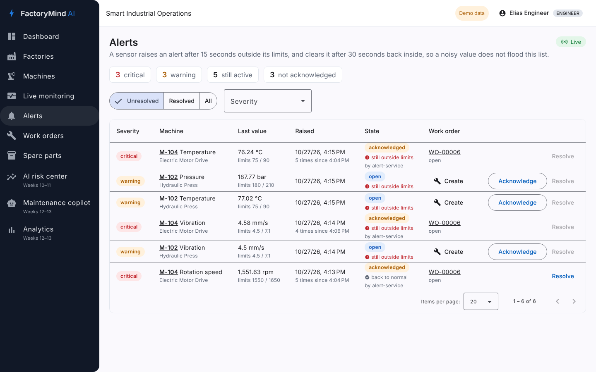
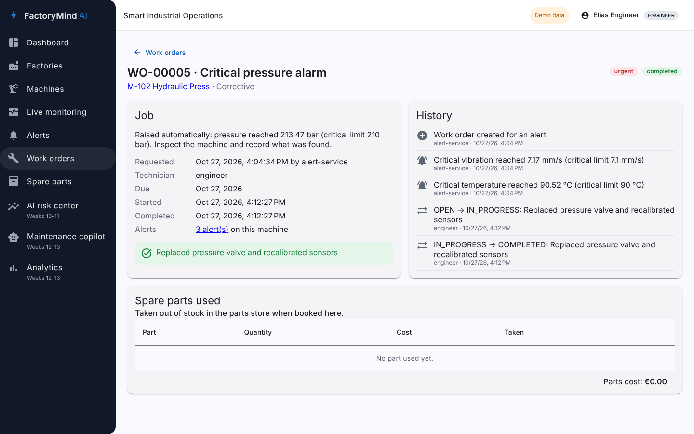

# FactoryMind AI — Smart Industrial Operations Platform

FactoryMind AI watches factory machines, detects abnormal behaviour and helps maintenance teams act before a
breakdown stops production. It is built as event-driven Spring Boot microservices with an Angular front end,
a Python ML service and Power BI analytics.

> **Demo project.** All factories, machines and sensor data are simulated. Thresholds in the demo data are
> illustrative, not industrial limits.






## What works today (phases 1–5)

| Area | Status |
|---|---|
| Factories, production lines, machines, sensor alarm limits (CRUD, search, filters, paging) | ✅ |
| Machine status (OPERATIONAL / WARNING / STOPPED / MAINTENANCE) and fleet summary | ✅ |
| API gateway in front of every service | ✅ |
| Angular dashboard, machine list, machine details, new machine form, factories | ✅ |
| Flyway migrations, demo data, RFC 9457 error responses, optimistic locking | ✅ |
| Unit, web-slice and Testcontainers integration tests, GitHub Actions CI | ✅ |
| Keycloak login (OIDC + PKCE), JWT validation in the gateway and the asset service, ADMIN / ENGINEER / OPERATOR roles | ✅ |
| Kafka (KRaft): sensor limits shared by asset-service, readings, status changes, dead-letter topics | ✅ |
| Telemetry service: threshold checks, history, latest values, live stream (SSE), sensor simulator | ✅ |
| Live monitoring screen: every sensor with sparkline, limits and a feed of status changes | ✅ |
| Alert service: debounced alerts from sensor status changes, acknowledge / resolve, live stream | ✅ |
| Maintenance service: work orders (auto-created from critical alerts), status workflow, parts used, history, MTTR | ✅ |
| Inventory service: spare parts, stock movements ledger, receipts, stock counts, low-stock view | ✅ |
| Failure-risk model (Python, scikit-learn, FastAPI) trained on simulated run-to-failure data, with a model card | ✅ |
| AI insights service: live risk per machine from Kafka telemetry, inspection work order when a machine turns HIGH | ✅ |
| Spring AI: maintenance report per machine (Claude or Ollama) | ✅ |
| Maintenance copilot: RAG on machine manuals and procedures (hybrid search Postgres full-text + pgvector), cited sources, live plant data through tool calls, document upload (Markdown, text, PDF) | ✅ |
| Preventive maintenance plans | Later |
| Power BI reports | Weeks 12–13 |
| Observability (Prometheus, Grafana) | Weeks 14–15 |

## Architecture

```
                 login (PKCE)
Angular (4200) ─────────────────► Keycloak (8180/auth, realm factorymind)
      │ Bearer token, live streams (SSE)       ▲ signing keys (JWKS)
      ▼                                        │
API Gateway (8080) ─┬─► asset-service (8081) ──────► PostgreSQL asset_db
                    ├─► telemetry-service (8082) ──► PostgreSQL telemetry_db
                    ├─► alert-service (8083) ──────► PostgreSQL alert_db
                    ├─► maintenance-service (8084) ► PostgreSQL maintenance_db
                    │        │ REST: issue / return parts (token relayed)
                    ├─► inventory-service (8086) ──► PostgreSQL inventory_db
                    └─► ai-insights-service (8087) ► PostgreSQL insights_db (+ pgvector: manuals)
                             │ REST /predict           │ Spring AI (optional)
                             ▼                         ▼
                     ml-service (8090, Python)   Claude API or Ollama (chat), Ollama (embeddings)

Kafka (9092)
  asset.sensor-definitions   asset ──► telemetry
  telemetry.readings         simulator / plant gateways ──► telemetry
  telemetry.sensor-status    telemetry ──► alert (debounce)
  alert.alerts               alert ──► maintenance (critical alert opens a work order)
  maintenance.work-orders    maintenance ──► alert (acknowledge, resolve when completed), ai-insights
  ai.risk-levels             ai-insights ──► maintenance (HIGH risk plans an inspection)
  (ai-insights also reads sensor-definitions, readings and alerts)
```

Each service owns its database; services talk over REST for queries and Kafka for events.
A reading travels: simulator or `POST /api/telemetry/readings` → `telemetry.readings` → telemetry-service
(limits check, stored, latest state) → live stream to the browser, and `telemetry.sensor-status` when a sensor
changes level. See [ADR 0003](docs/adr/0003-kafka-telemetry.md).
A status change then becomes an alert once it lasts 15 s (and clears after 30 s back to normal); a critical
alert opens an urgent work order, or joins the open one of the same machine; the technician books spare parts
on it, which takes them out of stock. See [ADR 0004](docs/adr/0004-alerts-maintenance-inventory.md).
Every 10 s, ai-insights-service sends each machine's latest readings to the Python model, which returns the
probability that a sensor reaches its critical limit within 24 h and the reasons; a machine that turns HIGH gets
an inspection work order, usually minutes before the first alert in the demo. See
[ADR 0005](docs/adr/0005-ai-insights-ml.md).
The maintenance copilot answers "how do I fix / check / work safely on this machine" from the manuals and
procedures: it finds the best passages with Postgres full-text search and pgvector embeddings merged by rank,
gives them to the language model with the live risks, alerts and work orders as tools, and the answer cites
each passage as [n]. See [ADR 0006](docs/adr/0006-maintenance-copilot-rag.md).
Decisions are recorded in [`docs/adr`](docs/adr).

## Security

Keycloak issues the tokens; the Angular app signs in with the authorization code flow and PKCE (`keycloak-js`)
and sends the access token to `/api`. The gateway rejects any call without a valid token and a FactoryMind role,
then forwards the token; the asset service checks it again and applies the role rules:

| Role | Can do |
|---|---|
| OPERATOR | Read factories, lines, machines and sensors; report a machine's status |
| ENGINEER | Everything an operator does, plus create and edit machines and sensor limits |
| ADMIN | Everything, including factories, production lines and deletes |

Every role can watch live and historical readings; pushing readings over HTTP needs ENGINEER or ADMIN.

| Area | OPERATOR | ENGINEER | ADMIN |
|---|---|---|---|
| Alerts | Read, acknowledge | + resolve | Same as engineer |
| Work orders | Read, create | + edit, change status, book parts | Same as engineer |
| Spare parts | Read | + create / edit parts, receive deliveries | + stock counts, delete parts |
| AI | Read risks, ask the copilot | + machine reports, add / remove copilot documents | Same as engineer |

Demo accounts (realm import in `infrastructure/keycloak/factorymind-realm.json`; change them before any real use):

| User | Password | Role |
|---|---|---|
| `admin` | `admin` | ADMIN |
| `engineer` | `engineer` | ENGINEER |
| `operator` | `operator` | OPERATOR |

Keycloak admin console: http://localhost:8180/auth/admin (`KEYCLOAK_ADMIN` / `KEYCLOAK_ADMIN_PASSWORD`, default
`admin` / `admin`). See [ADR 0002](docs/adr/0002-keycloak-security.md).

## Tech stack

Java 25 · Spring Boot 4.0.9 · Spring Cloud 2025.1.4 (Gateway) · Spring for Apache Kafka · Apache Kafka 4.3 (KRaft) ·
Spring Data JPA · Flyway · PostgreSQL 17 + pgvector · Server-Sent Events ·
Spring AI 2.0.1 (Anthropic Claude, Ollama, tool calling, embeddings, PDF reader) · RAG with hybrid search ·
Python 3.13 · scikit-learn 1.9 · FastAPI · pytest ·
Angular 22 (standalone components, signals, `rxResource`, reactive forms, Angular Material) · Vitest ·
JUnit 5 · Mockito · Testcontainers · Docker Compose · GitHub Actions.

Spring Cloud 2025.1.x supports Spring Boot 4.0.x, not 4.1.x, so the project stays on Boot 4.0.9 until a
compatible Spring Cloud release train is available.

## Run it

### Everything in Docker

```bash
cp .env.example .env
docker compose up --build
```

Open http://localhost:4200 and sign in with one of the demo accounts. **Live monitoring** shows the simulated
sensors; M-102 and M-104 slowly degrade to critical and recover every 6 minutes. A few seconds after they
turn critical, **Alerts** shows the alarms and **Work orders** gets an urgent order for each machine.
**AI risk center** flags them earlier: their risk turns HIGH while the readings are still below the warning
limit, and an inspection work order appears before the alert.

Reports and the copilot use a language model only if you choose one in `.env`:
`AI_CHAT_PROVIDER=anthropic` with `ANTHROPIC_API_KEY`, or `AI_CHAT_PROVIDER=ollama` with
`docker compose --profile ollama up -d` and `docker compose exec ollama ollama pull llama3.2` (free, local).
Without one, reports are rule-based and the **Maintenance copilot** returns the best manual passages instead of
writing an answer; risk scoring never needs a language model. To let the copilot also search by meaning, set
`AI_EMBEDDING_PROVIDER=ollama` and pull the embedding model once:
`docker compose exec ollama ollama pull nomic-embed-text` (this works with Claude as the chat model too).

| URL | What |
|---|---|
| http://localhost:8085 | Kafka UI: topics, messages, consumer lag, dead-letter topics |
| http://localhost:8081/swagger-ui.html | asset-service API |
| http://localhost:8082/swagger-ui.html | telemetry-service API |
| http://localhost:8083/swagger-ui.html | alert-service API |
| http://localhost:8084/swagger-ui.html | maintenance-service API |
| http://localhost:8086/swagger-ui.html | inventory-service API |
| http://localhost:8087/swagger-ui.html | ai-insights-service API |
| http://localhost:8090/docs | Python model API (internal; open in dev only) |

Already ran an earlier phase? `docker compose up --build` is enough: the `db-init` container creates
the missing databases (`telemetry_db`, `alert_db`, `maintenance_db`, `inventory_db`, `insights_db`) in the existing Postgres volume.
Coming from before phase 6, recreate the Postgres volume once (`docker compose down -v`): Postgres now runs on the
Debian-based `pgvector/pgvector` image, whose text sorting differs from the old Alpine one. The demo data comes back
on start.

### For development

```bash
docker compose up -d postgres db-init kafka kafka-ui keycloak

# Backend (JDK 25; with JDK 21 add -Djava.version=21), one terminal each
cd backend
./mvnw -pl asset-service spring-boot:run
SIMULATOR_ENABLED=true ./mvnw -pl telemetry-service spring-boot:run
./mvnw -pl alert-service spring-boot:run
./mvnw -pl inventory-service spring-boot:run
./mvnw -pl maintenance-service spring-boot:run
./mvnw -pl ai-insights-service spring-boot:run
./mvnw -pl api-gateway spring-boot:run

# Python model (Python 3.13)
cd ml/predictive-maintenance
python -m venv .venv && .venv/bin/pip install -r requirements-dev.txt   # Windows: .venv\Scripts\pip
python -m factorymind_ml.train --out model
uvicorn factorymind_ml.api:app --port 8090

# Frontend (Node 22.22.3+ or 24)
cd frontend/factorymind-web
npm install
npm start                                 # proxies /api to the gateway on :8080
```

Start with an empty database instead of the demo data:
`FLYWAY_LOCATIONS=classpath:db/migration`.

Signed-in call from a terminal: the web client has no password grant, so take the token from the browser
(DevTools > Network > any `/api` call > `Authorization` header) and pass it as `-H "Authorization: Bearer <token>"`.

### Tests

```bash
cd backend && ./mvnw verify                  # needs Docker for the Testcontainers tests (PostgreSQL, Kafka)
cd frontend/factorymind-web && npx ng test --watch=false
cd ml/predictive-maintenance && python -m pytest -q
```

## Deploy

`docker-compose.prod.yml` runs the published images behind Caddy (automatic HTTPS), with Keycloak at
`https://$DOMAIN/auth` stored in `keycloak_db`, and a private Kafka broker (set `KAFKA_CLUSTER_ID` once in `.env`).
The `db-init` container creates any missing service database on each start. `.github/workflows/deploy.yml`
tests, builds and pushes the images to GHCR on every push to `main`, then updates the server over SSH once the
`SERVER_HOST`, `SERVER_USER`, `SERVER_SSH_KEY` secrets and the `DEPLOY_ENABLED=true` variable are set.

## API (asset-service, through the gateway)

| Method | Path | Purpose |
|---|---|---|
| GET/POST | `/api/factories` | List / create factories |
| GET/PUT/DELETE | `/api/factories/{id}` | Read / update / delete (409 while lines exist) |
| GET/POST | `/api/production-lines?factoryId=` | List / create lines |
| GET/PUT/DELETE | `/api/production-lines/{id}` | Read / update / delete (409 while machines exist) |
| GET | `/api/assets?q=&status=&criticality=&factoryId=&lineId=&page=&size=` | Search machines |
| GET | `/api/assets/summary` | Counts by status and criticality |
| GET/POST | `/api/assets`, `/api/assets/{id}` | Create / read machines |
| PUT/DELETE | `/api/assets/{id}` | Update / delete a machine |
| PATCH | `/api/assets/{id}/status` | Change machine status |
| GET/POST/PUT/DELETE | `/api/assets/{id}/sensors[/{sensorId}]` | Sensor alarm limits |

## API (telemetry-service, through the gateway)

| Method | Path | Purpose |
|---|---|---|
| GET | `/api/telemetry/latest` | Latest value, status and limits of every sensor |
| GET | `/api/telemetry/readings?assetId=&sensorType=&minutes=15` | History, oldest first (max 1440 minutes, 5000 points) |
| GET | `/api/telemetry/stream` | Server-Sent Events: `reading` for each new value, `status` when a sensor changes level |
| POST | `/api/telemetry/readings` | Queue a reading on Kafka (`{"assetId", "sensorType", "value", "recordedAt"?}`), 202 |

## API (alert-service, through the gateway)

| Method | Path | Purpose |
|---|---|---|
| GET | `/api/alerts?status=&severity=&assetId=&sensorType=&active=&page=&size=` | Search alerts (`status` can repeat) |
| GET | `/api/alerts/summary` | Unresolved alerts: critical, warning, active, not acknowledged |
| GET | `/api/alerts/{id}` | One alert |
| GET | `/api/alerts/stream` | Server-Sent Events: `alert` on every change |
| POST | `/api/alerts/{id}/acknowledge` | Acknowledge |
| POST | `/api/alerts/{id}/resolve` | Resolve once the condition has cleared (`{"note"}`), 422 while still active |

## API (maintenance-service, through the gateway)

| Method | Path | Purpose |
|---|---|---|
| GET | `/api/maintenance/work-orders?q=&status=&priority=&type=&assetId=&alertId=&page=&size=` | Search work orders |
| GET | `/api/maintenance/summary` | Counts by status, open, overdue, urgent, MTTR, completed in 30 days |
| GET/POST | `/api/maintenance/work-orders`, `/api/maintenance/work-orders/{id}` | Create (optionally from an `alertId`) / read with parts and history |
| PUT | `/api/maintenance/work-orders/{id}` | Edit title, description, priority, assignee, due date |
| PATCH | `/api/maintenance/work-orders/{id}/status` | Move in the workflow (`{"status", "note"}`; a note is required to complete) |
| POST | `/api/maintenance/work-orders/{id}/parts` | Use a spare part (`{"partId", "quantity"}`), takes it out of stock |
| DELETE | `/api/maintenance/work-orders/{id}/parts/{lineId}` | Remove a part line and return it to stock |

## API (inventory-service, through the gateway)

| Method | Path | Purpose |
|---|---|---|
| GET | `/api/inventory/parts?q=&category=&lowStock=&page=&size=` | Search spare parts |
| GET | `/api/inventory/summary` | Parts, low stock, out of stock, stock value |
| GET/POST/PUT/DELETE | `/api/inventory/parts[/{id}]` | Spare part catalogue |
| GET | `/api/inventory/parts/{id}/movements`, `/api/inventory/movements?workOrderId=` | Stock ledger |
| POST | `/api/inventory/parts/{id}/receipts` | Receive a delivery (`{"quantity", "reference", "unitCost"?}`) |
| POST | `/api/inventory/parts/{id}/issues`, `/returns` | Used by maintenance-service, idempotent by `requestId` |
| POST | `/api/inventory/parts/{id}/adjustments` | Stock count (`{"countedQuantity", "note"}`), ADMIN |

Errors use RFC 9457 problem details, for example:

```json
{ "status": 409, "title": "Conflict", "detail": "Asset code 'M-104' is already used" }
```

## API (ai-insights-service, through the gateway)

| Method | Path | What |
|---|---|---|
| GET | `/api/insights/risks` | Latest failure risk of every machine, highest first, with per-sensor reasons |
| GET | `/api/insights/risks/{assetId}`, `/history?minutes=` | One machine, and its risk over time |
| GET | `/api/insights/model` | Model card: training data, feature importances, metrics against the warning rule |
| POST | `/api/insights/assets/{assetId}/report` | Maintenance report (language model, or rule-based), ENGINEER/ADMIN |
| GET | `/api/insights/copilot` | Language model, embedding model, retrieval mode, documents and passages |
| POST | `/api/insights/copilot/ask` | `{"question", "assetId"?, "history"?}`: answer citing manual passages as [n], with the passages |
| GET | `/api/insights/knowledge/documents`, `/{id}` | Manuals and procedures; one document cut into passages |
| POST | `/api/insights/knowledge/documents` | Multipart `file` (.md, .txt, .pdf, 10 MB) + `title`, `kind`, `machines`, ENGINEER/ADMIN |
| DELETE | `/api/insights/knowledge/documents/{id}` | Remove an uploaded document (built-in ones: 409), ENGINEER/ADMIN |

## Repository layout

```
backend/          Maven multi-module: asset, telemetry, alert, maintenance, inventory, ai-insights services and api-gateway
frontend/         Angular app (factorymind-web)
ml/               Python failure-risk model: features, simulated training data, training, FastAPI service
analytics/        Warehouse, ETL and Power BI (phase 4)
infrastructure/   Database init script, Keycloak realm, Caddy; later Prometheus, Grafana
docs/             ADRs, architecture notes, screenshots
```
