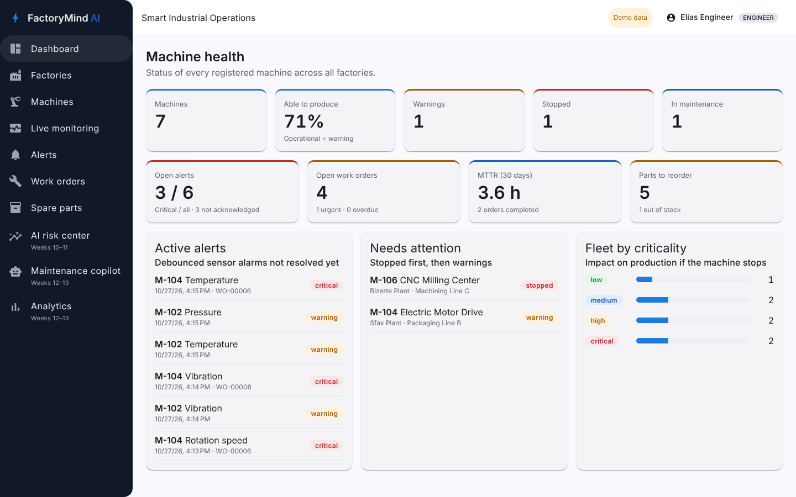
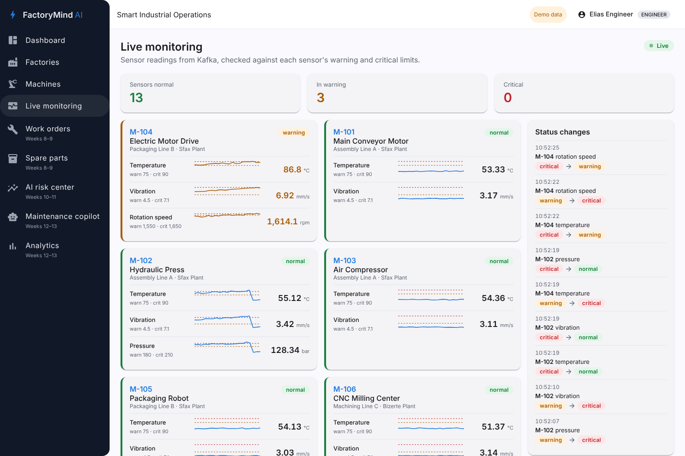

# FactoryMind AI — Smart Industrial Operations Platform

FactoryMind AI watches factory machines, detects abnormal behaviour and helps maintenance teams act before a
breakdown stops production. It is built as event-driven Spring Boot microservices with an Angular front end,
a Python ML service and Power BI analytics.

> **Demo project.** All factories, machines and sensor data are simulated. Thresholds in the demo data are
> illustrative, not industrial limits.





## What works today (phases 1–3)

| Area | Status |
|---|---|
| Factories, production lines, machines, sensor alarm limits (CRUD, search, filters, paging) | ✅ |
| Machine status (OPERATIONAL / WARNING / STOPPED / MAINTENANCE) and fleet summary | ✅ |
| API gateway in front of every service | ✅ |
| Angular dashboard, machine list, machine details, new machine form, factories | ✅ |
| Flyway migrations, demo data, RFC 9457 error responses, optimistic locking | ✅ |
| Unit, web-slice and Testcontainers integration tests, GitHub Actions CI | ✅ |
| Keycloak login (OIDC + PKCE), JWT validation in the gateway and the asset service, ADMIN / ENGINEER / OPERATOR roles | ✅ |
| Kafka (KRaft): sensor limits shared by asset-service, readings, status changes, dead-letter topics | ✅ |
| Telemetry service: threshold checks, history, latest values, live stream (SSE), sensor simulator | ✅ |
| Live monitoring screen: every sensor with sparkline, limits and a feed of status changes | ✅ |
| Work orders, preventive plans, spare parts | Weeks 8–9 |
| Anomaly detection and failure-risk model (Python, scikit-learn) | Weeks 10–11 |
| Maintenance copilot (Spring AI + RAG), Power BI reports | Weeks 12–13 |
| Observability (Prometheus, Grafana) | Weeks 14–15 |

## Architecture

```
                 login (PKCE)
Angular (4200) ─────────────────► Keycloak (8180/auth, realm factorymind)
      │ Bearer token, live stream (SSE)        ▲ signing keys (JWKS)
      ▼                                        │
API Gateway (8080) ──► asset-service (8081) ──► PostgreSQL asset_db
      │                      │ sensor limits (compacted topic)
      │                      ▼
      │                ┌──────────── Kafka (9092) ────────────┐
      │                │ asset.sensor-definitions             │
      │                │ telemetry.readings ◄── simulator / plant gateways
      │                │ telemetry.sensor-status ──► (next) alert, maintenance
      │                └──────────────────────────────────────┘
      │                      ▲ │
      └──► telemetry-service (8082) ──► PostgreSQL telemetry_db
```

Each service owns its database; services talk over REST for queries and Kafka for events.
A reading travels: simulator or `POST /api/telemetry/readings` → `telemetry.readings` → telemetry-service
(limits check, stored, latest state) → live stream to the browser, and `telemetry.sensor-status` when a sensor
changes level. See [ADR 0003](docs/adr/0003-kafka-telemetry.md).
Decisions are recorded in [`docs/adr`](docs/adr).

## Security

Keycloak issues the tokens; the Angular app signs in with the authorization code flow and PKCE (`keycloak-js`)
and sends the access token to `/api`. The gateway rejects any call without a valid token and a FactoryMind role,
then forwards the token; the asset service checks it again and applies the role rules:

| Role | Can do |
|---|---|
| OPERATOR | Read factories, lines, machines and sensors; report a machine's status |
| ENGINEER | Everything an operator does, plus create and edit machines and sensor limits |
| ADMIN | Everything, including factories, production lines and deletes |

Every role can watch live and historical readings; pushing readings over HTTP needs ENGINEER or ADMIN.

Demo accounts (realm import in `infrastructure/keycloak/factorymind-realm.json`; change them before any real use):

| User | Password | Role |
|---|---|---|
| `admin` | `admin` | ADMIN |
| `engineer` | `engineer` | ENGINEER |
| `operator` | `operator` | OPERATOR |

Keycloak admin console: http://localhost:8180/auth/admin (`KEYCLOAK_ADMIN` / `KEYCLOAK_ADMIN_PASSWORD`, default
`admin` / `admin`). See [ADR 0002](docs/adr/0002-keycloak-security.md).

## Tech stack

Java 25 · Spring Boot 4.0.9 · Spring Cloud 2025.1.4 (Gateway) · Spring for Apache Kafka · Apache Kafka 4.3 (KRaft) ·
Spring Data JPA · Flyway · PostgreSQL 17 · Server-Sent Events ·
Angular 22 (standalone components, signals, `rxResource`, reactive forms, Angular Material) · Vitest ·
JUnit 5 · Mockito · Testcontainers · Docker Compose · GitHub Actions.

Spring Cloud 2025.1.x supports Spring Boot 4.0.x, not 4.1.x, so the project stays on Boot 4.0.9 until a
compatible Spring Cloud release train is available.

## Run it

### Everything in Docker

```bash
cp .env.example .env
docker compose up --build
```

Open http://localhost:4200 and sign in with one of the demo accounts. **Live monitoring** shows the simulated
sensors; M-102 and M-104 slowly degrade to critical and recover every 6 minutes.

| URL | What |
|---|---|
| http://localhost:8085 | Kafka UI: topics, messages, consumer lag, dead-letter topics |
| http://localhost:8081/swagger-ui.html | asset-service API |
| http://localhost:8082/swagger-ui.html | telemetry-service API |

Already ran an earlier phase? `docker compose up --build` is enough: the `db-init` container creates
`telemetry_db` in the existing Postgres volume.

### For development

```bash
docker compose up -d postgres db-init kafka kafka-ui keycloak

# Backend (JDK 25; with JDK 21 add -Djava.version=21), one terminal each
cd backend
./mvnw -pl asset-service spring-boot:run
SIMULATOR_ENABLED=true ./mvnw -pl telemetry-service spring-boot:run
./mvnw -pl api-gateway spring-boot:run

# Frontend (Node 22.22.3+ or 24)
cd frontend/factorymind-web
npm install
npm start                                 # proxies /api to the gateway on :8080
```

Start with an empty database instead of the demo data:
`FLYWAY_LOCATIONS=classpath:db/migration`.

Signed-in call from a terminal: the web client has no password grant, so take the token from the browser
(DevTools > Network > any `/api` call > `Authorization` header) and pass it as `-H "Authorization: Bearer <token>"`.

### Tests

```bash
cd backend && ./mvnw verify                  # needs Docker for the Testcontainers tests (PostgreSQL, Kafka)
cd frontend/factorymind-web && npx ng test --watch=false
```

## Deploy

`docker-compose.prod.yml` runs the published images behind Caddy (automatic HTTPS), with Keycloak at
`https://$DOMAIN/auth` stored in `keycloak_db`, and a private Kafka broker (set `KAFKA_CLUSTER_ID` once in `.env`).
The `db-init` container creates any missing service database on each start. `.github/workflows/deploy.yml`
tests, builds and pushes the images to GHCR on every push to `main`, then updates the server over SSH once the
`SERVER_HOST`, `SERVER_USER`, `SERVER_SSH_KEY` secrets and the `DEPLOY_ENABLED=true` variable are set.

## API (asset-service, through the gateway)

| Method | Path | Purpose |
|---|---|---|
| GET/POST | `/api/factories` | List / create factories |
| GET/PUT/DELETE | `/api/factories/{id}` | Read / update / delete (409 while lines exist) |
| GET/POST | `/api/production-lines?factoryId=` | List / create lines |
| GET/PUT/DELETE | `/api/production-lines/{id}` | Read / update / delete (409 while machines exist) |
| GET | `/api/assets?q=&status=&criticality=&factoryId=&lineId=&page=&size=` | Search machines |
| GET | `/api/assets/summary` | Counts by status and criticality |
| GET/POST | `/api/assets`, `/api/assets/{id}` | Create / read machines |
| PUT/DELETE | `/api/assets/{id}` | Update / delete a machine |
| PATCH | `/api/assets/{id}/status` | Change machine status |
| GET/POST/PUT/DELETE | `/api/assets/{id}/sensors[/{sensorId}]` | Sensor alarm limits |

## API (telemetry-service, through the gateway)

| Method | Path | Purpose |
|---|---|---|
| GET | `/api/telemetry/latest` | Latest value, status and limits of every sensor |
| GET | `/api/telemetry/readings?assetId=&sensorType=&minutes=15` | History, oldest first (max 1440 minutes, 5000 points) |
| GET | `/api/telemetry/stream` | Server-Sent Events: `reading` for each new value, `status` when a sensor changes level |
| POST | `/api/telemetry/readings` | Queue a reading on Kafka (`{"assetId", "sensorType", "value", "recordedAt"?}`), 202 |

Errors use RFC 9457 problem details, for example:

```json
{ "status": 409, "title": "Conflict", "detail": "Asset code 'M-104' is already used" }
```

## Repository layout

```
backend/          Maven multi-module: asset-service, telemetry-service, api-gateway (more services added per phase)
frontend/         Angular app (factorymind-web)
ai/               Python ML services (phase 3)
analytics/        Warehouse, ETL and Power BI (phase 4)
infrastructure/   Database init script, Keycloak realm, Caddy; later Prometheus, Grafana
docs/             ADRs, architecture notes, screenshots
```
